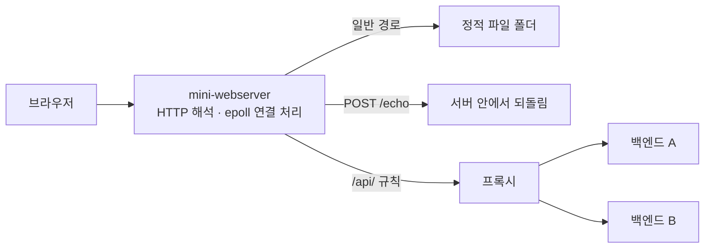
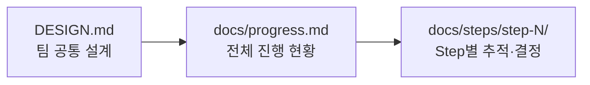

# mini-webserver

이 문서는 C와 POSIX 소켓으로 만든 웹 서버(+ 리버스 프록시)의 구현 범위, 구조, 실행 방법과 문서 탐색 경로를 기술하는 것을 목적으로 한다.

## 프로젝트 요약

외부 라이브러리 없이 C로 직접 만든 HTTP/1.x 웹 서버다. 학습 목적의 프로젝트이며 Step 0~8을 현재 브랜치에서 모두 진행했다 ([progress.md](./docs/progress.md)).

| 기능 | 내용 |
| ---- | ---- |
| 정적 파일 | `GET`으로 파일·`index.html` 제공, 경로 탈출 차단, 큰 파일 분할 전송 |
| `POST /echo` | 요청 본문을 그대로 돌려준다 (저장 없음) |
| 리버스 프록시 | `-c` 설정의 `route` 규칙에 맞는 요청을 백엔드로 전달 (예: `/api/` → 백엔드 `/`), 라운드 로빈, 502·504 |
| 연결 처리 | keep-alive, 크기 상한(414·431·413), 5초 무진행 제한, `epoll` 기반 다중 연결 |
| 종료·로그 | `SIGINT`·`SIGTERM` 시 진행 중 요청만 마치고 종료(최대 10초), 요청별 접근 로그 |

- 워커 스레드 4개로 연결을 처리하는 확장도 구현·검증했으나 세부 설계 선택은 `임시`다 ([워커 풀](./docs/extensions/worker-pool/README.md)).

## 구조와 요청 흐름



- 요청은 파서가 먼저 판정한다. 형식·크기 오류는 400·414·431 등으로 거절한다.
- 그다음 `route` 규칙에 맞으면 프록시, 아니면 `/echo`·정적 파일 순으로 처리한다.
- 프록시는 접두를 떼고 HTTP/1.0 요청으로 전달한다. `/api/menu` 요청은 백엔드의 `/menu`가 받는다.
- 백엔드 연결 실패는 502, 5초 무응답은 504다. 백엔드는 번갈아 고르며 실패해도 다른 쪽으로 재시도하지 않는다.

## 시연: 오늘의 카페 메뉴

서버 기능과 별개로, 이를 보여 주는 **시연용** 카페 메뉴 서비스가 `demo/`에 있다. 메뉴 API 백엔드(`demo/backend/backend.c`)는 시연 전용이며 서버에 내장된 기능이 아니다. 아래 화면은 시연에서 캡처한 한 시점의 예시다.


최근 기록을 고르면 클라이언트·서버·백엔드 단계별 내용을 볼 수 있다: [network-detail.png](./demo/screenshots/network-detail.png)

## 실행

저장소 루트에서 한 명령으로 띄운다. Docker와 `curl`이 필요하다.

```sh
./demo/run.sh          # 준비되면 http://127.0.0.1:8080/ 출력
./demo/run.sh stop     # 정지
```

- 이미 `mws-demo`가 돌고 있으면 스크립트가 교체하지 않는다. 다른 이름·포트로 띄운다: `./demo/run.sh --name mws-demo-2 --port 18080` → `http://127.0.0.1:18080/`
- 시연 순서: ① 서비스 체험에서 메뉴 불러오기·메모 POST(`/echo`) → ② 통신 보기에서 각 기록 선택 → ③ 장애와 동시성 탭에서 502·504·동시 요청.
- 통신 기록은 세션 안에서만 보이며 새로고침하면 초기화된다.
- 자세한 절차와 수동 장면: [demo/README.md](./demo/README.md)

## 문서 정리



- 문서 전체 안내: [docs/README.md](./docs/README.md)
- 최근 검증 기록(Step 8, 2026-11-26 한 번의 측정·현행 TC 기준): [Step 8 검증 기록](./docs/steps/step-8-final/README.md#3-검증-기록)

## 알고 싶은 것으로 찾기

| 알고 싶은 것 | 문서 |
| ------------ | ---- |
| 요구사항 | [requirements.md](./docs/requirements.md) |
| 구조와 설계 선택 | [architecture.md](./docs/architecture.md) |
| 선택 과정 | [decisions.md](./docs/decisions.md) → Step의 `decision.md` |
| 테스트 기록 | [test-plan.md](./docs/test-plan.md) |
| 검증 결과 | [verification.md](./docs/verification.md) |
| Step별 요구사항·테스트·구현·검증 | `docs/steps/step-N-이름/README.md` |
| 배경 지식 | [docs/study/](./docs/study/00-overview.md) |
| 회고 | [docs/retrospective.md](./docs/retrospective.md) |

## 폴더 구조

```text
mini-webserver/
├── README.md · DESIGN.md    소개 · 팀 공통 설계
├── src/ · tests/            웹 서버 구현 · 시험
├── demo/                    시연 페이지 · 백엔드 · 실행 스크립트 · 캡처
├── Dockerfile · Makefile    실행 환경 · 빌드
└── docs/
    ├── README.md    문서 안내
    ├── progress.md · requirements.md · architecture.md
    ├── decisions.md · test-plan.md · verification.md
    ├── assignment.md                       과제 원문
    ├── technical-writing-principles.md     문서 작성 기준
    ├── retrospective.md                    회고
    ├── steps/step-N-이름/                  README.md(진행 추적) · decision.md(결정 기록)
    └── study/                              학습 자료
```
