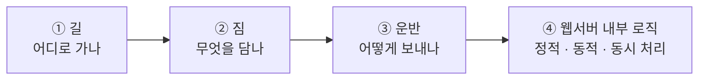
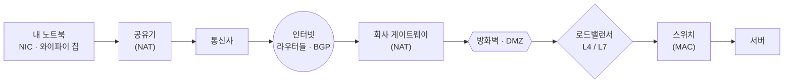

# Mini Webserver 프로젝트 회고

## 1. 한 줄 요약

**팀이 함께 큰 그림을 먼저 그리고 세부를 파고드니, 애매하게 알던 개념이 하나씩 정확해졌다.**
로드밸런서·프록시·라우팅이 각각 무슨 일을 하는지, 그리고 I/O 멀티플렉싱이 멀티스레드나 폴링과 무엇이 다른지를 깊이 이해하게 됐다.

---

## 2. 어떻게 공부했나

### 2-1. 큰 그림에서 세부로

구현에 들어가기 전에 팀원들과 함께 **"안녕하세요"라는 데이터 하나가 내 노트북에서 서버 프로그램까지 어떻게 가는가**를 큰 그림으로 그렸다.
이 큰 그림은 데이터를 세 가지 관점으로 나눠 보는 틀이었다.

> 이 화살표는 데이터가 이동하는 방향이 아니라 **바라보는 관점을 옮겨 간 순서**다.
> 데이터는 ①의 길 위를 ②의 짐 형태로, ③의 방식으로 운반되어 간다. 세 관점이 한 장면을 함께 설명한다.

**① 길: 데이터가 인터넷을 지나 서버까지 가는 경로**

**② 짐: 그 길 위에 무엇이 실리는가**

- 결국 0과 1만 오가므로, "어느 칸에 무엇을 넣을지" 약속한 것이 **프로토콜**이다.
- 칸(헤더)을 역할별로 나눈 것이 **TCP/IP 4계층**이고, 각 계층은 자기 헤더 뒤를 내용물로만 보는 **캡슐화** 구조다.
- 맨 안쪽에는 **HTTP 메시지**가 있다. HTTP는 무상태라서 필요한 맥락을 메시지에 모두 담아야 하고, 그래서 정확한 파싱이 중요하다.

**③ 운반: 양 끝에서 누가 어떻게 보내고 받는가**

- 브라우저는 HTTP 메시지만 만들고, TCP 이하는 **OS**가 처리한다.
- 프로그램은 OS가 만들어 주는 소켓(fd)에 읽고 쓴다. 서버는 `socket → bind → listen → accept → read/write → close` 순서로 동작한다.
- TCP는 순서 번호와 재전송으로 **훼손 없이, 빠짐없이, 순서대로** 전달하고, 3-way handshake로 연결을 맺는다.

큰 그림을 그린 뒤에는 그 위의 각 부분을 하나씩 파고들었다.

| 공부 순서 | 주제 | 큰 그림에서의 위치 |
| --------- | ---- | ----------------- |
| 1 | 웹서버의 등장 배경 | 큰 그림 전체 (왜 이런 구조가 되었나) |
| 2 | 네트워크 계층 | ② 짐 |
| 3 | TCP | ③ 운반 |
| 4 | 소켓 | ③ 운반 (서버 쪽 끝) |
| 5 | HTTP 메시지 | ② 짐 (맨 안쪽) |
| 6 | 정적·동적 콘텐츠 | ④ 웹서버 내부 로직 |
| 7 | 동시성 모델 | ④ 웹서버 내부 로직 |
| 8 | 프록시 | ① 길의 로드밸런서 자리 + ④ 동적 요청 처리 |
| 9 | 견고성 | ④ 웹서버 내부 로직 (잘못된 요청, 끊긴 연결, 종료) |

각 부분을 공부한 뒤 바로 그 부분에 해당하는 단계를 구현했다.
예를 들어 "TCP에는 메시지 경계가 없다"를 공부한 직후에 HTTP 요청의 경계를 직접 자르는 파서를 짰고, 동시성 모델을 비교해 본 직후에 이벤트 루프를 만들었다.

### 2-2. 중간 공유

팀원들과 공부한 내용을 중간중간 서로 설명했다.
큰 그림을 함께 그려 두었기 때문에, 누가 어떤 주제를 이야기하든 **그게 큰 그림의 어디에 해당하는지 모두가 알고 있었다.** 그래서 설명이 엇갈리지 않고 같은 그림 위에서 이야기할 수 있었다.

설명하다 보면 내가 당연하게 생각하던 부분에서 질문이 나왔고, 대답하려다 보니 내가 정확히 모르고 있었다는 걸 알게 되는 경우가 많았다.
아래 3장의 개념들이 대부분 그렇게 바로잡은 것들이다.

---

## 3. 애매했다가 정확해진 개념들

### 3-1. 프록시, 라우팅, 로드밸런싱: "역할"의 이름

세 단어가 비슷한 장면에서 함께 나오다 보니 처음에는 경계가 흐릿했다. 정리하고 나니 **셋 다 장비나 프로그램이 아니라 "하는 일"의 이름**이었다.

- **프록시는 방식이다.** 손님의 요청을 받아 주고, 손님 대신 다른 서버에 보낸다. 그래서 프록시는 서버이면서 동시에 클라이언트이고, **연결이 두 개**다. 따로 만드는 서버가 아니라 역할이라서 웹서버에 기능으로 넣을 수 있다(nginx가 그렇다).
- **라우팅은 어떤 역할로 보낼지** 정하는 일이다. `/api/` 요청을 API 서버 그룹으로 보낸다.
- **로드밸런싱은 같은 역할 중 누구에게 보낼지** 정하는 일이다. API 서버 여러 대 중 8002번으로 보낸다.

가장 헷갈렸던 건 "L7 로드밸런서가 경로를 보고 나눠 보내니까, 로드밸런싱이 곧 라우팅인가?"였다.
답은 아니다. L7 로드밸런서는 HTTP 내용까지 볼 수 있어서 라우팅을 **덤으로** 같이 하는 것이다. 이름이 로드밸런서라서 두 일이 하나로 보였을 뿐이다.

헷갈릴 때 던지는 질문 네 개로 정리했다.

1. 연결이 하나인가, 둘인가? → 둘이면 프록시
2. 누구 편인가? → 손님 편이면 포워드, 서버 편이면 리버스
3. 보낼 곳이 여럿인가? → 여럿이면 로드밸런싱
4. HTTP 내용을 읽는가? → 읽으면 L7

이렇게 정리하고 나니 내 서버도 정확히 부를 수 있었다. 정적 요청에는 웹서버이고 `/api` 요청에는 리버스 프록시이므로, **"리버스 프록시 기능을 갖춘 웹서버"** 다.

### 3-2. 동시성: 서버는 무엇을 기다리는가

이번 프로젝트에서 가장 깊게 파고든 주제다. 처음에는 멀티스레드든 epoll이든 "여러 요청을 동시에 처리하는 방법"으로 같은 선상에 놓고 봤다.
공부하면서 **서버가 기다리는 대상이 두 종류**이고, 각각 맞는 도구가 다르다는 걸 알게 됐다.

| | 문제 A: 소켓이 비어 있다 | 문제 B: 서버 쪽 일이 오래 걸린다 |
| - | ----------------------- | ------------------------------- |
| 기다리는 대상 | 클라이언트 (언제 보낼지 모름) | 파일 읽기, DB 조회, 긴 계산 같은 서버 작업 |
| 기다리는 시간 | 정해지지 않음. keep-alive 연결은 대부분 비어 있음 | 짧고 언젠가 끝남 |
| 문제의 본질 | 기다리는 동안 **처리 흐름이 연결에 묶인다** | 일하는 동안 **다른 요청이 밀린다** |
| 맞는 도구 | **I/O 멀티플렉싱** | **여러 실행 흐름 (프로세스, 스레드)** |

#### 문제 A: 소켓이 비어 있다 → I/O 멀티플렉싱

| 방식 | 데이터가 없을 때 | 한계 |
| ---- | --------------- | ---- |
| 블로킹 | 커널이 스레드를 재움 | CPU는 안 쓰지만 **스레드가 소켓 하나에 묶임** |
| 논블로킹 + 폴링 | 즉시 `EAGAIN`, 프로그램이 계속 다시 물음 | 묶이지는 않지만 **busy-wait로 CPU 낭비** |
| I/O 멀티플렉싱 | 소켓 **여러 개**를 커널에 맡기고 잠, 준비된 것만 알려 받음 | 묶이지도, 낭비하지도 않음 |

- 핵심은 **"준비됐는지 확인하는 일을 누가 하느냐"** 다. 폴링은 프로그램이 묻고 다니고, 멀티플렉싱은 커널이 지켜보다 알려 준다.
- select·poll은 매번 모든 소켓을 훑지만, epoll은 관심 목록을 한 번 등록해 두고 **준비된 것만** 돌려준다. 기다리는 연결 하나는 구조체 하나일 뿐이라 연결이 많아도 감당할 수 있다.
- 대가로, 스레드가 연결을 오가며 처리하므로 **연결마다 진행 상태를 구조체에 직접 저장**해야 한다.

#### 문제 B: 서버 쪽 일이 오래 걸린다 → 여러 실행 흐름

epoll은 소켓이 준비됐는지만 알려 줄 뿐, 디스크 대기나 긴 계산까지 논블로킹으로 만들어 주지는 않는다.
이벤트 루프 스레드가 하나뿐이면, 그 스레드가 서버 일로 잠든 동안 **모든 연결이 멈춘다.** 그래서 실행 흐름을 여러 개 두는 방법을 비교했다.

| 방식 | 구조 | 장점 | 단점 |
| ---- | ---- | ---- | ---- |
| **프로세스 (`fork`)** | 요청이나 연결마다 자식 프로세스 | 격리가 강함. 하나가 죽어도 나머지는 안전 | 생성·전환 비용이 큼. 프로세스끼리 데이터 공유가 어려움 |
| **스레드 풀** | 미리 만든 스레드 N개가 번갈아 일함 | 생성 비용이 없고 데이터 공유가 쉬움 | 공유하는 만큼 동기화가 필요. 하나가 죽으면 전체에 영향 |

같은 스레드인데 문제 A에서는 실패하고 문제 B에서는 답이 되는 이유는 **기다리는 시간**에 있었다.
손님은 언제 올지 몰라 손님 수만큼 스레드가 필요하지만, 서버 일은 금방 끝나므로 스레드 몇 개만 있어도 번갈아 CPU를 채운다.

#### 둘을 합치는 방법

실제 서버는 epoll로 문제 A를, 스레드 풀로 문제 B를 함께 푼다. 합치는 구조도 두 가지를 비교했다.

| 구조 | 동작 | 장점 | 단점 |
| ---- | ---- | ---- | ---- |
| **스레드마다 epoll** | 스레드들이 듣는 소켓을 공유하고, 각자 epoll을 가져 받은 연결을 끝까지 맡음 (nginx 방식) | 연결이 한 스레드에 고정되어 **잠금이 거의 필요 없음** | 한 스레드에 무거운 연결이 몰리면 그 스레드의 다른 연결도 함께 밀림 |
| **epoll 하나 + 작업 큐** | 루프 스레드 하나가 epoll로 준비된 연결을 골라 큐에 넣고, 워커는 꺼내서 **일만** 함 | 남는 워커가 바로 가져가므로 일이 고르게 나뉨. 역할이 분명함 | 큐에 잠금이 필요하고, 같은 연결이 두 워커에게 동시에 가지 않도록 막아야 함 |

같은 도구라도 **무엇을 기다리느냐**에 따라 실패하기도 하고 정답이 되기도 한다. 이걸 이해하고 나니 "epoll이냐 스레드냐"가 아니라 **"어떤 기다림을 무엇이 맡느냐"** 로 질문이 바뀌었다.

### 3-3. 그 밖에 정확해진 것들

- **TCP에는 메시지 경계가 없다.** 바이트가 흐름으로 올 뿐이라, 요청 하나를 잘라 내는 건 HTTP의 몫이다. 머리는 `\r\n\r\n`으로, 본문은 `Content-Length`로 자른다.
- **TCP는 기억하고, HTTP는 기억하지 않는다.** 연결은 상태를 갖지만 그 위의 요청 하나하나는 독립적이다.
- **블로킹은 바쁘게 기다리는 게 아니다.** 블로킹된 스레드는 커널이 스케줄링에서 빼 두기 때문에 몇 시간을 기다려도 CPU를 거의 쓰지 않는다. 블로킹의 문제는 CPU가 아니라 **흐름이 묶이는 것**이다.

---

## 4. 구현하면서 내린 중요한 선택들

### 4-1. 동시성은 epoll 먼저, 스레드 풀은 그 위에

- **선택:** 연결마다 프로세스나 스레드를 붙이지 않고, **epoll 기반 이벤트 루프**로 동시성을 먼저 해결했다. 그 위에 **작업 큐 + 워커 스레드 풀**을 확장으로 얹었다.
- **이유:** 3-2에서 정리한 대로 웹서버의 연결 대부분은 비어 있는 소켓(문제 A)이다. keep-alive를 지원하는 이상 이 문제가 먼저였고, 서버 쪽 작업으로 막히는 문제(문제 B)는 그다음이라고 판단했다.
- **결과물에 준 영향:**
  - 서버 전체가 **연결별 상태 기계**로 바뀌었다. 요청을 읽는 중인지, 본문을 버리는 중인지, 응답을 보내는 중인지를 연결 구조체에 저장하고, 응답도 연결별 출력 버퍼에 만들어 소켓이 받아 주는 만큼씩 나눠 보낸다. 블로킹 코드보다 훨씬 복잡해졌지만, 느린 클라이언트 하나가 다른 연결을 막지 않게 됐다.
  - 타임아웃 방식도 바뀌었다. 소켓 옵션(`SO_RCVTIMEO`)은 블로킹 호출에서만 의미가 있어서, 연결마다 **"읽기·쓰기 진행이 없는 시간 5초"** 를 직접 재는 방식으로 바꿨다.
  - 이벤트 루프를 "루프는 등록과 수명 관리, 연결 처리는 상태 전이"로 나눠 둔 덕분에, 스레드 풀을 얹을 때 이 경계를 그대로 **스레드 경계**로 쓸 수 있었다. 대신 레벨 트리거 epoll은 처리 중인 연결도 계속 알려 주기 때문에, 큐에 넣기 전에 등록을 잠시 빼서 **한 연결은 동시에 한 워커만** 처리하도록 보장해야 했다.

### 4-2. 리버스 프록시도 같은 이벤트 루프 안에서

- **선택:** 프록시를 별도 스레드나 블로킹 호출로 만들지 않고, **백엔드 소켓도 같은 epoll에 등록**했다. 백엔드 연결(`connect`)도 논블로킹으로 맺는다. 라우팅(가장 긴 접두 경로의 규칙 고르기)과 로드밸런싱(규칙마다 라운드 로빈)은 3-1의 구분대로 따로 구현했다.
- **이유:** 백엔드 응답을 기다리는 것도 결국 "비어 있는 소켓을 기다리는" 문제 A다. 여기서 블로킹하면 4-1에서 얻은 이점이 프록시 요청마다 사라진다.
- **결과물에 준 영향:** 연결 하나가 클라이언트와 백엔드 **소켓 두 개**를 갖게 되면서, 연결 상태와 epoll 등록 관리가 한 단계 더 복잡해졌다. 대부분의 시간에는 둘 중 하나만 등록하고, 요청 본문을 업로드하는 동안에만 두 소켓을 함께 본다.

### 4-3. 프록시 실패는 "응답 머리를 보냈는가"로 나눈다

- **선택:** 클라이언트에 응답 머리를 보내기 **전**의 실패는 502(연결 실패, 잘못된 응답)나 504(시간 초과)로 응답하고, 보낸 **뒤**의 실패는 연결만 닫는다. 그래서 백엔드 응답 머리를 끝까지 검증하기 전에는 클라이언트에 **한 바이트도 쓰지 않는다.** 실패한 백엔드를 다른 백엔드로 재시도하지는 않는다.
- **이유:** 상태 코드는 응답의 첫 줄이라 한 번 보내면 바꿀 수 없다. 검증 전에 중계를 시작하면, 백엔드가 이상한 응답을 줬을 때 클라이언트는 200을 받다가 갑자기 끊기는 응답을 받게 된다. 재시도는 요청 본문을 보관해야 해서 범위에서 뺐다.
- **결과물에 준 영향:** 클라이언트는 항상 **완전한 응답 아니면 명확한 502·504**를 받는다. 대신 백엔드 하나가 꺼져 있으면, 라운드 로빈에서 그 백엔드 차례가 된 요청은 다른 백엔드가 살아 있어도 502를 받는다.

### 4-4. 연결마다 메모리를 고정하고, 크기 상한을 둔다

- **선택:** 요청 머리는 연결마다 **8KB 고정 버퍼**에 받는다. 머리 8KB·URI 2KB·본문 1MB를 넘으면 각각 431·414·413으로 거절한다. 파서는 지금까지 받은 바이트 전체를 매번 다시 판정하는 상태 없는 함수로 만들었다.
- **이유:** 이벤트 루프에서는 연결 수가 곧 메모리 사용량이다. 연결마다 크기가 정해져 있어야 연결이 늘어도 사용량을 예측할 수 있고, 할당 실패나 누수가 생길 자리도 없다. 상한이 8KB라 매번 다시 판정해도 비용이 작다.
- **결과물에 준 영향:** 큰 요청이나 악의적인 요청이 서버 메모리를 키우지 못한다. 파서가 소켓·상태와 분리되어 있어서 경계 조건(줄 바꿈 오류, 상한 직전·직후 크기)을 소켓 없이 단위 시험으로 촘촘하게 확인할 수 있었다.

---

## 5. 돌아보며

### 좋았던 점

- 큰 그림을 함께 그린 뒤 세부를 공부해서, 팀원 모두가 같은 그림을 보며 이야기할 수 있었다.
- 중간 공유 덕분에 혼자였다면 오해한 채 넘어갔을 개념들을 바로잡았다.
- 공부한 개념이 설계 선택의 근거가 됐다. "왜 epoll인가", "왜 프록시도 논블로킹이어야 하는가"를 스스로 설명할 수 있게 됐다.

### 아쉬웠던 점

- **공부에 초점을 맞추느라 결과물 자체의 완성도를 높이는 데 신경 쓰지 못했다.**
- **설계적인 선택을 할 때, 특정 시나리오가 아닌 범용 서버를 생각하다 보니 정확한 기준을 가지고 판단하기 쉽지 않았다.** 머리 상한을 8KB로 할지, 타임아웃을 몇 초로 할지, 워커를 몇 개 둘지, 실패한 백엔드를 재시도할지 같은 선택은 "어떤 트래픽을 받는 서버인가"가 정해져야 답이 나온다. 기준이 없으니 매번 흔한 기본값이나 단순함을 근거로 고를 수밖에 없었다.

### 다음에 해 볼 것

- 설계를 시작하기 전에 **대상 시나리오를 먼저 정한다.** 예를 들어 "정적 파일 위주, 동시 연결 수천 개" 또는 "API 위주, 느린 백엔드"처럼 정해 두고, 상한·타임아웃·워커 수를 그 시나리오에 맞춰 정하고 측정으로 확인한다.
- 공부와 구현의 시간 배분을 처음부터 나눠, 결과물을 다듬는 시간을 따로 확보한다.

---

## 6. 마치며

웹서버를 만든다는 건 결국 **"무엇을 기다리고, 그 기다림을 누가 맡는가"** 를 정하는 일이었다.
TCP가 바이트를 실어 나르고, HTTP가 그 안에서 요청의 경계를 정하고, 커널이 비어 있는 소켓들을 지켜보고, 워커가 서버 쪽 일을 맡고, 프록시가 손님 대신 백엔드에 다녀온다.
이름만 알던 개념들이 각자 어떤 역할을 맡는지 하나의 그림 안에서 보이게 된 것이 이번 프로젝트에서 얻은 가장 큰 수확이다.
